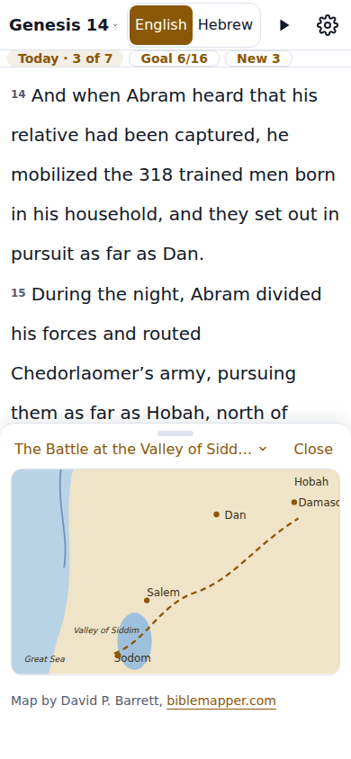
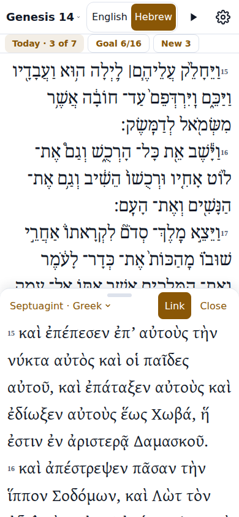
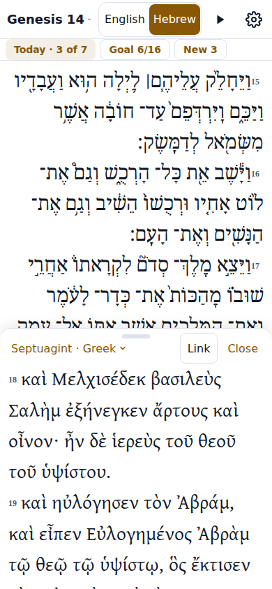
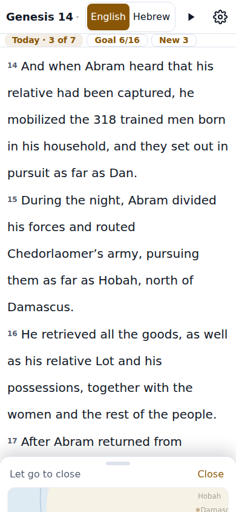
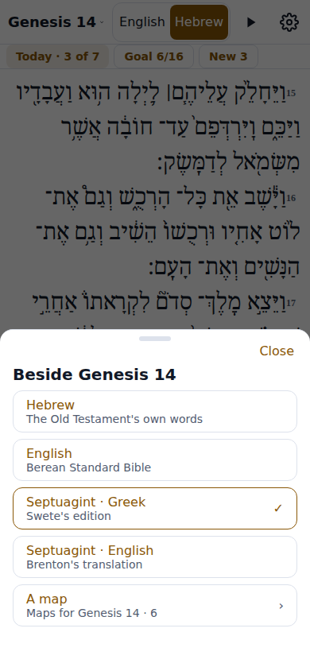
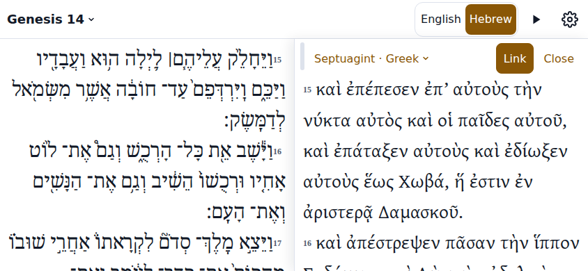

# The Reader split: a map or a second text beside the passage

A design pass (mw-5r3p30.1131, Fable at xhigh, the Governor's ask of 2026-11-06) for the two held stories mw-5r3p30.1129 (a map beside the passage) and
mw-5r3p30.1130 (a second text beside it, kept in step). Design only: no app code here. The mockups are the PNGs under `docs/design/reader-split/`, rendered from
`docs/design/reader-split/mockup.html` (static HTML, no app code) by `docs/design/reader-split/render.mjs` at the phone's 390x844. Everything here is
**PROVISIONAL**: the Mayor takes the recommended option of each decision (his word of 17:53:41Z, "use your best judgment") and the Governor is shown what was chosen.

His words that rule it (Postern general, 2026-11-06, dictated):

- 17:42Z: "there are certain times where I would like to be able to look at the map and read the text at the same time I know logos has like a split screen feature right where you can have two different things"
- 17:48Z: "I want to compare the you know say the English MSB English of the [Septuagint] ... I could even see comparing the Greek [Septuagint] with the Hebrew Old Testament"
- 17:49Z: "logos has a cool feature where you can keep to related texts in sync so you scroll one and automatically Scrolls the other ... obviously it wouldn't apply to a map"
- 17:50Z: "it can't be clunky it's got to be delightful"

Read with the rig's own rules: one hand on a phone, large clear type, the page never scrolls (each box scrolls on its own), every gesture has a button, and
"easy to use correctly and hard to use incorrectly". One note on his second want: the English the app has beside the Septuagint is Brenton's translation, and the
Old Testament's plain English is the Berean Standard Bible (the Majority Standard Bible is the New Testament's); the chooser below says whose each text is.

<!-- toc -->

- [The one idea: a sheet that docks](#the-one-idea-a-sheet-that-docks)
- [Opening and closing](#opening-and-closing)
- [The divider](#the-divider)
- [Portrait, sideways and wide](#portrait-sideways-and-wide)
- [The map pane and a text pane](#the-map-pane-and-a-text-pane)
- [The Link](#the-link)
- [A word tap](#a-word-tap)
- [What is remembered](#what-is-remembered)
- [Not done](#not-done)
- [Prior art](#prior-art)
- [Decisions](#decisions)
  - [D1 Where the dock stands in portrait](#d1-where-the-dock-stands-in-portrait)
  - [D2 Where 'Split' opens a text from](#d2-where-split-opens-a-text-from)
  - [D3 Back and the split](#d3-back-and-the-split)
  - [D4 The divider's sizes](#d4-the-dividers-sizes)
- [Revised acceptance criteria](#revised-acceptance-criteria)
  - [mw-5r3p30.1129 A map beside the passage](#mw-5r3p301129-a-map-beside-the-passage)
  - [mw-5r3p30.1130 A second text beside the passage, kept in step](#mw-5r3p301130-a-second-text-beside-the-passage-kept-in-step)
- [How the mockups were made](#how-the-mockups-were-made)

<!-- /toc -->

## The one idea: a sheet that docks

Every reference thing in Lampas already comes up from the bottom as a sheet over the passage: the Maps sheet, a map, a word, the Talk sheet. Each has the same
handle row (a pill, Close at the right), takes Back, and closes on a drag down. The split adds nothing to learn: **it is a sheet that stops halfway**. 'Split' on
a map, or a text chosen from the Verse view's new Split door, docks the sheet: it settles at half the screen, the passage shows above it, and the two scroll on
their own. The handle row every sheet has becomes the divider: drag it up for more, down for less, down past the smallest size to close, as a sheet closes today.
Nothing in the Reader moves or appears while nothing is docked.

| State | Mockup |
| --- | --- |
| A map docked under Genesis 14 (the Battle at the Valley of Siddim, a stand-in drawing; the real picture is Bible Mapper's, shown from the site) |  |
| The Septuagint's Greek under the Hebrew, Link on: verse 15 heads both panes |  |
| The same with Link off: the Greek scrolled on to Melchizedek (18) while the Hebrew stays at 15 |  |
| Closing: the handle row pulled down past the smallest size, the dock's words fading, the row saying what letting go does |  |
| The chooser, 'Beside Genesis 14': the texts this chapter has and a map, the current one ticked |  |
| Sideways (844x390): the passage at the left, the dock at the right, its pill on the divider |  |

## Opening and closing

**A map.** On a map (`src/maps/MapView.tsx`, the second sheet) a `Split` button stands beside `Close` in the handle row (his word for it; one word, and the
place a reader's eye already goes). Tapping it closes the map sheet, the Maps list under it and the Verse view in one go (they are Back steps: the Builder pops
them as `closeVerse` does), and the Reader shows with the passage at the verse the Verse view was on and the map settled in the dock at Half. The Maps list
itself has no Split: a list is not something to read beside; a map is.

**A text.** The Verse view's Tools line (`Copy`, `Share`, `Memorize`, `In Logos`, `In another book…`, `Maps · N`, `Sermons · N`) gains one more quiet word at its
end, `Split`. It opens a bottom sheet headed `Beside Genesis 14` (the chapter's title) with one row per text the chapter has, each with whose it is on a second
line, and `A map` last (`Maps for Genesis 14 · 6`, which opens the Maps sheet) when the chapter has maps:

- a New Testament chapter: `Greek` (the Byzantine text) and `English` (Majority Standard Bible);
- an Old Testament chapter whose Septuagint is shipped: `Hebrew`, `English` (Berean Standard Bible), `Septuagint · Greek` (Swete's edition), `Septuagint · English` (Brenton's translation);
- an Old Testament chapter without one: `Hebrew` and `English`.

Tapping a text closes the sheet and the Verse view and docks that text at the verse. The text the passage shows now is offered too, not greyed: the English
under the Hebrew while the switch stays on Hebrew is a fair want. Why the Verse view and not the Reader's own chrome: it is where every door beside a verse
already lives (Maps, Sermons, In Logos; his rule of 2026-11-03 kept the Reader's foot clear of doors), the dock opens at the verse he tapped, and the Reader shows
nothing new to a reader who wants "just English". Decision D2 weighs the alternative, a chip.

**Swapping.** The dock's name, at the left of its handle row (`Septuagint · Greek ▾`, or a map's title `▾`), opens the same chooser (a text) or the Maps sheet for
the chapter (a map), with the current one ticked. So a second text changes without leaving the split, and a map is swapped for the chapter's other maps.

**Closing**, three ways, all the sheets' own:

- `Close` at the right of the handle row: the dock slides off in 200 ms (the bars' own time, `src/Away.tsx`; none under `prefers-reduced-motion`) and the passage takes the whole box without its scroll moving.
- A drag down on the handle row past the smallest size by 80 px (`CLOSE_DISTANCE`, the sheets' own in `src/ui/sheetDrag.ts`): as the finger crosses it the row's name becomes `Let go to close` and the dock's words fade (closing.png); letting go closes, letting go before it snaps back to Small.
- `Close the split`, a button of `src/ReaderControls.tsx` (the Reader's buttons for what is otherwise a gesture), shown while focused, for a keyboard and TalkBack.

Not Back, not Escape: the split is a layout, not a sheet on top of one (decision D3). Not the chooser: it has no 'Close the split' row, because Close is already on the row.

## The divider

The handle row is the divider: 44 px tall, the pill in the middle (the sheets' own `h-1.5 w-10 rounded-full bg-line`), the dock's name at the left (a button:
the chooser or the Maps sheet), `Link` and `Close` at the right (`Link` for a text only). The whole row is the drag surface (`touch-none`, pointer events so a
mouse drags it too), as a sheet's handle row is. Nothing else resizes the split: a scroll inside either pane never moves the divider (`overscroll-contain` in both).

**Three sizes, not a free divider.** Small, Half and Large: the dock takes a third, a half or two thirds of the box under the chips (at 390x844 the box is 748 px:
249, 374 and 499 px, the row included). The drag follows the finger live; letting go settles on the nearest size in 200 ms; above Large stays at Large; below
Small by 80 px closes (above). Both a map and a text open at Half: a map at the box's width (382 px) is about 240 px tall and fits Half with its credit; Half
gives two text panes of about seven 44 px lines each. Why not free sizing: a free divider invites fiddling, leaves slivers that hold half a line, and cannot be
proven by a test; three sizes are predictable, each one a known picture, and the Immersive bars going away or the phone turning recomputes them from the box with
no drift (decision D4).

**Buttons for the gesture** (docs/accessibility.md 'Gesture-only actions'): `Larger split` and `Smaller split` join `Close the split` in `src/ReaderControls.tsx`,
shown while focused, stepping through the three sizes.

## Portrait, sideways and wide

- **Portrait (the phone)**: stacked; the passage above, the dock below (decision D1). The header, the switch and the chips row stay above the passage unchanged. With
  the Immersive reader On the bars slide away on the passage's scroll as today (a scroll inside the dock does not hide them), the box grows and the dock keeps
  its fraction. The speaking bar of Read aloud, when it shows, stands under the dock as it stands under the text today, and the dock's body gives it the room.
  The place line (`Genesis 14 · 45%`) is not drawn while a dock is open in Scroll (the dock's row is the passage's foot); in Turn pages it stays, since it says the page.
- **Sideways** (`short:`, `max-height: 500px`): side by side; the passage at the left, the dock at the right half, the handle row at the dock's top with its pill
  standing on the divider at the left edge (text-sideways.png). The sizes are thirds of the width; a drag right past Small closes. The passage keeps the left
  because reading begins there and the dock is the sheet that slid in from the right edge; the Hand setting does not move it (one rule to learn).
- **Wide** (a tablet or a desktop window, `min-width: 768px`, at any height): as sideways; at Half each pane is as wide as a phone.
- **Turning the phone** keeps the size (Half stays Half) and the scroll of each pane's top verse.
- **Turn pages** (Settings > Reading): the passage pane turns pages in its shorter box as it does today, the dock scrolls; the Link follows the page's first verse. Not proven in the first two stories (see Not done).

## The map pane and a text pane

**The map pane** holds one map. The handle row's name is the map's title (cut with an ellipsis where long; the whole title is in the Maps sheet it opens); the
body is `MapView`'s own box: the picture at the box's width, a tap toggling fit and twice the width, panned by scrolling the box, pinch where the phone allows
(`[touch-action:pan-x_pan-y_pinch-zoom]`), and under it the credit Bible Mapper asks on every map (`Map by David P. Barrett, biblemapper.com`), then `About this
map`, `Full size` and `All maps for Genesis 14 at Bible Mapper`, reached by scrolling the body. A pinch or a pan inside the box moves nothing outside it, and
the passage's scroll never moves the box. Offline the box says `The map needs the internet` and the links stay, as today.

On moving chapter (the buttons, a swipe, the picker, a link) the dock stays. The map stays if it is among the new chapter's maps (a region map spans chapters);
else the dock shows the new chapter's first map in the Maps sheet's order; else the row reads `No map for Genesis 15` (quiet, muted) over an empty body, no
picture fetched, and the dock keeps its size: the split never shuts itself and comes back.

**A text pane** holds the chosen text's verses of the open chapter, drawn by the Reader's own `VerseText` in one plain view: no weave, no section headings, no
Variants braces, no reading highlight. Verse numbers are the Reader's; a Septuagint verse whose numbering differs shows both, `1 (22:1)`, as the Reader does
(`septuagintNumber`). Hebrew runs right to left in the Hebrew face; the Text size setting applies. The Septuagint of a Hebrew chapter is the Greek chapter(s)
whose verses are in this Lampas chapter (`public/data-lxx/index.json`; Psalm 23 is Greek Psalm 22) and only those verses. A passage verse with no partner in
the chosen text gets a muted row at its place in the dock, `15 · Not in the Septuagint`, so the dock's sequence is the passage's and nothing is ever blank; a
dock verse with no Lampas number is drawn with its own number alone, as the Reader draws it today. A chapter the text does not exist for (Romans 8 with
`Septuagint · Greek`) keeps the split with the quiet row `No Septuagint for Romans` over an empty body, as a chapter with no map does.

## The Link

The `Link` button on the handle row, pressed (accent, `aria-pressed`) by default, drawn for a text and never for a map (his word: it would not apply to one).

**Linked.** The pane under the finger leads and the other follows by verse: when the leader's top verse changes (the verse whose top is at or above the pane's
top edge and whose bottom is below it, `useKeepTopVerse`'s rule), the follower scrolls so that verse's first line sits at its own top edge, at once. Not a smooth
scroll: a follower that eases lags the finger and looks broken; Logos's and Accordance's panes jump too. The leader is set at `pointerdown`, `touchstart` or
`wheel` on a pane and cleared when its scroll ends (`scrollend`, or 150 ms of quiet), and the follower's own scroll events are ignored meanwhile, so there is no
feedback loop. A scroll the passage makes itself (Read aloud bringing the verse being read into view, a link opening at a verse) counts as the passage leading.

**By verse, not by pixel.** Greek runs longer than English and Hebrew shorter; a ratio of scroll heights drifts within a chapter (Accordance's staff say the same
of line-by-line locking). The unit is the verse, Lampas's number, which both panes carry.

**Unlinked.** Each pane scrolls alone and keeps its place. Pressing `Link` again brings the dock to the passage's top verse (the passage leads at that moment).
Moving chapter sends both panes to the new chapter's top (or the verse a link asks for), linked or not.

One switch for two panes: no link-set letters, no three-state icon.

## A word tap

- In either pane a tap on a word opens the word sheet the Reader opens (`src/reader/Tap.tsx`: a Greek word's, a Hebrew word's, an English word's), over both
  panes; nothing in the split changes while it is open, and closing it (Back, as today) leaves the split as it was. Tap to hear and the rest of the sheet work as ever.
- A hold on a word copies as today (`src/copy/useCopyHold.ts`): in the dock, that pane's verse in that pane's text.
- A tap on a verse number in the passage opens the Verse view as today, over both panes; the dock stays underneath and is there when the view closes. A tap on a
  verse number in the dock brings the passage to that verse (`useBringVerse`), and linked, the dock follows to its top: a quiet way to jump both panes.
- The dock has no section headings, so no passage opens from it; the Verse view stays the passage's.
- The floating ? sits where the Hand setting puts it, over the dock's lower corner; he double-taps to hide it as ever (never a bug). The tutor is told what is
  beside the passage (below).

## What is remembered

Settings in the registry (`src/settings/define.ts`, Dexie, live in the Reader as `useReaderSettings`'s are), app-wide, not per book or chapter:

| Key | Values | Note |
| --- | --- | --- |
| `readerSplit` | `off` \| `map` \| `text` | what is docked |
| `splitText` | the text's key (`hebrew`, `english`, `lxx-greek`, `lxx-english`, `greek`, `msb`) | read while `readerSplit` is `text` |
| `splitMap` | the map's source and id | read while `readerSplit` is `map`; a reload shows the same map |
| `splitSize` | `small` \| `half` \| `large` | the dock's size |
| `splitLink` | `on` \| `off` | the Link; `on` by default |

A reload brings the split back as it was (his AC 5 of mw-5r3p30.1129). Not remembered: each pane's scroll (the Reader's scroll memory stays the passage's, per
address; the dock follows the passage on opening, or starts at its top when unlinked). No Settings row draws these (the split is chosen and closed in place);
the keys exist so the tutor can be told, and each is classified in `src/tutor/knows.ts` (`BEARS_ON`: bible-talk is told what is beside the passage, since he may
ask about a difference he is looking at; verse-read and tips are not), which `tests/unit/tutor-knows.test.ts` holds. `npm run grind:build` after adding them.

## Not done

- No third pane, because a phone has room for two and the one Link is for two; Logos's letters serve many panels, which is not the ask.
- No free divider, only three sizes, because a free one invites fiddling, leaves slivers, and has no picture a test can hold (decision D4).
- No Back or Escape to close the split, because it is a layout that survives a reload, with no history step to pop, and after a verse or a word has been opened and closed "Back closes the split" would be a surprise (decision D3).
- No split on the Verse view, Memorize or any other screen, because the split is the Reader's reading layout; those screens open over both panes.
- No Link for a map, because his word ("obviously it wouldn't apply to a map") and a map has no verses to follow; a map follows the chapter, not the scroll.
- No weave, headings, variants or reading highlight in the dock, because the dock is for comparing texts, and the learning tools stay in the passage, where the tutor and the Verse view are.
- No side-by-side panes in portrait on a phone, because two 190 px columns hold three Greek words a line.
- No chapter of its own for the dock (a swipe moves both), because the Reader reads one chapter at a time and comparing different chapters is not the ask.
- No 'Split' on the Maps list sheet, because a list is not read beside the text; one map is, and it has the button.
- No Link that scrolls by pixel ratio, because the texts' lengths differ and a ratio drifts; the verse is the unit.
- No pinch between the panes to resize, because the handle row is enough and a pinch over a map is its zoom.
- No place of the dock on the Hand's side, because the panes are read, not reached for, and one rule (the passage left, the dock right) is easier to learn.
- No Settings row for the split, because it is chosen and closed in place, and a second way to the same thing is a way to use it incorrectly.
- No remembering a split per book or per chapter, because the Reader's other choices (view, weave, layout) are app-wide and a split that comes and goes by chapter would feel broken.
- No proof of the split with Turn pages in the first two stories, because paging in a shorter box should simply work and proving it (a page's first verse leading the Link) is one more e2e, a follow-up story of its own.
- No two maps, and no map beside a second text, because that is three things on a phone's screen.

## Prior art

| App | The second pane | Opening, closing | The link | Does well | Does badly | Source |
| --- | --- | --- | --- | --- | --- | --- |
| Logos mobile (the tab-based app) | Below in portrait, beside in landscape | A Split Screen icon at the top right of a tab, then a resource from the library; closed by dragging the half-circle at the middle to an edge, or the tab view's × | A link icon at the upper left, then a circle on each resource to keep in step, then Done | The link is explicit and visible; split is one word | Linking is three taps in a modal; closing is hidden; a user reports linked panes landing on wrong verses with Scroll View on Android | https://community.logos.com/discussion/234157/split-screen-linking, https://community.logos.com/discussion/comment/984439 |
| Logos desktop | Any panel, any side | Panels opened from the library; a link set chosen from each panel's Dynamic Toolbar (Home > Link Set) | Link Sets A to F: panels with the same letter navigate and scroll together | Scales to many panels; one letter does both navigate and scroll | Letters are a concept to learn and must be set twice; 'follow only' (one leads, the other never moves it) was still being asked for | https://support.logos.com/hc/en-us/articles/360016827711, https://logos.com/features/link-sets, https://community.logos.com/discussion/comment/1358886 |
| Olive Tree | The Study Center, a window below the main window (a sheet from the bottom) | A button in the lower right opens it; a resource or the Parallel tab inside | A small icon in the split window's lower right with three states: Do Not Link, Unlink on Scroll, Always Linked; the main window leads | The split is a sheet from the bottom, where the thumb is; 'Unlink on Scroll' lets the second pane go when you scroll it and re-locks on a tap | A three-state icon is tiny and hard to read; Parallel Bibles live in another tab than the split; a tablet user found no way in | https://help.olivetree.com/hc/en-us/articles/4404168662157-Using-Commentaries, https://www.olivetree.com/blog/create-parallel-bibles-olive-tree-bible-app/ |
| YouVersion | A second translation in a pane beside the reading (parallel reading) | The book icon at the top right, then a translation for the second pane; an option at the bottom of the pane keeps the two in sync as you scroll | A plain keep-in-sync option | One tap in; sync is one switch | Parallel is translations only (no map, no tools); the sync option is at the bottom of the pane, where it is easy to miss | https://thesweetsetup.com/how-to-compare-versions-in-youversion/ |
| Accordance (desktop help; mobile from a 2015 forum reply) | Parallel panes side by side | Added from the Parallel tab; on mobile a link/unlink icon at the top of the second pane | Tie Scrolling, on by default: each pane moves the same number of verses, the top verse aligned | Tied by the verse, the right unit; tied by default | Untied panes drift and users ask for a 'catch up'; staff say line-by-line locking cannot work across translations | https://accordancefiles1.com/helpfiles/Win13/content/topics/04_gswa/work_with_panes.htm, https://forums.accordancebible.com/topic/35880-panel-linking-for-scrolling-synching-and-also-having-one-catch-up-with-the-other/ |

What this design takes: Olive Tree's sheet at the bottom and its humane link; Accordance's tie by the top verse, on by default; YouVersion's one tap in and
one plain switch; Logos's word 'Split' and its link between two things, without the letters. What it leaves: hidden closes, three-state icons, modal linking.
The sources are forum and blog posts where no official page exists; the apps' menus move between versions. Checked 2026-11-06: the YouVersion guide and the Accordance help were read in full; the Logos community threads and Olive Tree's help page refused this host (HTTP 403), so their rows rest on the search index's extracts of those pages, and a Builder with a browser should read them before building the Link.

## Decisions

Four, each A or B with the recommended one; the Mayor chooses (his word of 17:53:41Z).

### D1 Where the dock stands in portrait

- A: Below the passage: the sheet that was already at the bottom settles there; the passage keeps the top with its header, switch and chips; the dock, its Link and Close and a map's pinch are at the thumb; it closes by the drag down every sheet closes by.
- B: Above the passage, as mw-5r3p30.1129's acceptance criteria were first written ("the map in the top part"): the passage stays at the thumb, but the sheet must fly from the bottom to the top, the dock's row sits under its content where the sheets' rows never are, and closing needs a new gesture.
- Recommended: A. His words asked for both at once, not for the map on top; A is the one idea with nothing new to learn.

### D2 Where 'Split' opens a text from

- A: The Verse view's Tools line, after `Sermons · N`: the one place doors beside a verse live, the dock opens at the verse he tapped, the Reader's chrome stays as it is, and the dock's own name swaps the text afterwards.
- B: A `Split` chip in the Reader's chips row: one tap fewer from the Reader, but a control among status chips, scrolled off the row's end when the row is full, gone with the Immersive bars, and shown to every reader, including one who wants "just English".
- Recommended: A.

### D3 Back and the split

- A: Back never closes the split; `Close`, the drag down and the `Close the split` button do. Back goes where it went before: out of a word sheet, a Verse view, a chapter.
- B: Back closes the split when it was the last thing opened (one history step, like a sheet), and does its usual work otherwise.
- Recommended: A. B has no step to pop after a reload, and makes Back mean two things.

### D4 The divider's sizes

- A: Three sizes (Small, Half, Large: a third, a half, two thirds of the box), the drag live and settling on the nearest; below Small closes.
- B: A free divider with a floor of 120 px on each pane.
- Recommended: A.

## Revised acceptance criteria

Each item names how it is checked; the e2e specs run at 390x844 under the `shots` project unless they say otherwise. The map story carries the dock, the divider,
the sizes and the settings; the text story carries the chooser, the text panes, the pairing and the Link. Files the Mayor may list: `src/reader/split/` (`Dock.tsx`
the dock and its handle row, `useSplit.ts` the state and the drag, `splitSettings.ts`, `useLinkedScroll.ts`, `SplitChooser.tsx`, `splitTexts.ts` which texts a
chapter has, `splitPairing.ts`), `src/settings/definitions/split.ts`, `src/maps/MapView.tsx` (the Split button), `src/VerseView.tsx` (the Split door), `src/Reader.tsx`
(the box becomes a column: the passage, the dock), `src/ReaderControls.tsx`, `src/tutor/knows.ts`, `src/help.ts`, `docs/layout/reader.md`, `docs/maps.md`.

### mw-5r3p30.1129 A map beside the passage

1. Genesis 14, the Verse view of verse 15, `Maps · 6`, a map: the map's handle row has `Split` beside `Close`; tapping it closes the map, the Maps sheet and the Verse view and shows the Reader with the map docked below the passage at Half: the dock's box is half the box under the chips within 10 px, its handle row 44 px tall with the map's title at the left and `Close` at the right and no `Link`, the picture wholly visible, and verse 15 within the passage's box (e2e, tests/e2e/map-split.spec.ts).
2. The passage scrolls on its own: scrolling it by 300 px moves the dock's box and the picture not at all; a tap on the picture zooms it to twice the box's width and scrolling the box pans it with the passage's scrollTop unchanged (e2e).
3. The drag: a touch drag of the handle row to two thirds of the box settles the dock at Large within 10 px, and a drag above that stays at Large; a drag down past Small by 80 px turns the row's name into `Let go to close` and, let go, closes the split with the passage's scrollTop unchanged; let go before that it settles at Small (e2e, `hasTouch`).
4. `Close` closes the split at the same verse; Back with the split open does not: a verse opened from the passage and closed with Back leaves the split as it was (e2e).
5. `Larger split`, `Smaller split` and `Close the split` are buttons of ReaderControls, shown while focused, and step through the sizes and close (e2e, tests/e2e/no-gesture-only.spec.ts extended).
6. The next chapter (`Genesis 15 ›`) keeps the split and shows a map of Genesis 15 (the same map if it covers the chapter, else the chapter's first in the Maps sheet's order); on a chapter `mapsFor` answers nothing for (the Builder finds one from `src/maps/data/biblemapper.json`) the row reads `No map for <Book N>`, the body is empty, no picture is fetched, and the dock keeps its size (e2e).
7. A reload keeps the split, the same map and the size (settings `readerSplit`, `splitMap`, `splitSize`) (e2e); each new setting is classified in `src/tutor/knows.ts` (unit test, tests/unit/tutor-knows.test.ts).
8. Sideways at 844x390 the dock stands at the right half with the passage at the left, its handle row at the dock's top, and a drag right past Small closes it (e2e, viewport 844x390).
9. A word tap in the passage opens the word sheet over both panes and closing it leaves the split (e2e); the place line is not drawn while the dock is open in Scroll (e2e).
10. `docs/maps.md` and `docs/layout/reader.md` say where the split lives, and Help's maps page says what `Split` does, in one sentence (gate).
11. The rig's gate passes (gate). Sweep, in the closing comment: every other bottom sheet of the Reader that shows reference matter beside the text, and whether it should dock; named for a follow-up, not built.

### mw-5r3p30.1130 A second text beside the passage, kept in step

1. The Verse view's Tools line ends with `Split`; on Genesis 14:15 it opens the sheet `Beside Genesis 14` with the rows `Hebrew`, `English` (Berean Standard Bible on its second line), `Septuagint · Greek` (Swete's edition), `Septuagint · English` (Brenton's translation) and `A map` (`Maps for Genesis 14 · 6`); on Romans 8:28 the rows are `Greek`, `English` (Majority Standard Bible) and `A map` when Romans 8 has maps (e2e, tests/e2e/reader-split-text.spec.ts).
2. Choosing `Septuagint · Greek` closes the sheet and the Verse view and docks the Greek at Half: its handle row reads `Septuagint · Greek` at the left with `Link` pressed and `Close` at the right, Greek verse 15 is the dock's top verse and Hebrew 15 the passage's (e2e).
3. Link on: scrolling the passage until verse 18 is its top verse puts Greek 18 at the dock's top within one line; scrolling the dock until 20 is its top verse brings the passage's top verse to 20; the follower's own scroll never scrolls the leader back (e2e).
4. Link off (a tap on `Link`, `aria-pressed` false): scrolling the dock to 20 moves the passage not at all and scrolling the passage moves the dock not at all; pressing `Link` again brings the dock to the passage's top verse (e2e).
5. Psalm 23 with `Septuagint · Greek`: the dock shows Greek Psalm 22, its verses numbered `1 (22:1)` as the Reader numbers them, and the pairing of a Lampas verse to its Greek verse is pure (`splitPairing.ts`, unit test, tests/unit/split-pairing.test.ts; e2e on Psalm 23).
6. A passage verse with no partner gets the muted row `<n> · Not in the Septuagint` at its place in the dock, never a blank (unit test on a synthetic chapter; e2e on a chapter the sweep names).
7. A tap on a Greek word in the dock opens its word sheet over both panes, and closing it leaves the split; a tap on a dock verse number brings the passage to that verse (e2e).
8. The dock's name opens the chooser with `Septuagint · Greek` ticked; choosing `Hebrew` swaps the dock's text at the same top verse; choosing `A map` opens the Maps sheet and a map's `Split` swaps the dock for the map (e2e).
9. The next chapter keeps the split and the text; a chapter the text does not exist for (Romans 8 with `Septuagint · Greek`) shows the row `No Septuagint for Romans` over an empty body with the split open (e2e).
10. A reload keeps the split, the text, the Link and the size (settings `readerSplit`, `splitText`, `splitLink`, `splitSize`) (e2e); each new setting is classified in `src/tutor/knows.ts` (unit test).
11. Sideways at 844x390 two text panes stand side by side, the passage at the left, and the Link holds (e2e, viewport 844x390).
12. Sweep: `scripts/split-pairing-sweep.ts` pairs every verse of every shipped Septuagint book both ways and writes the unpaired counts per book to `docs/split-pairing-sweep.md`, the totals in the closing comment (gate: the doc is committed and named in CLAUDE.md's Read by need).
13. The rig's gate passes, and the map split of mw-5r3p30.1129 still passes its spec (gate).

## How the mockups were made

`docs/design/reader-split/mockup.html` is one static page with `?state=map | linked | unlinked | closing | chooser | sideways`; its chrome copies `src/index.css`'s
light tokens, sizes and faces by hand (the fonts are the rig's own files under `src/fonts/`). The verses are Genesis 14 from `public/data/gen/14.json` (the Hebrew
and the Berean English) and Swete's Greek with Brenton's English typed in (the Septuagint chapter files are built, not committed). The map is a stand-in drawing:
Bible Mapper's picture is shown from the site and never copied. `node docs/design/reader-split/render.mjs` (after `npm ci`) renders the PNGs with Playwright's
Chromium at 390x844, sideways at 844x390. `tests/unit/reader-split-design.test.ts` holds this document's parts and the PNGs' size.
