# The timeline strip: its look, motion and feel

The design (mw-fnvjof.17.317.4, Fable at xhigh, the Governor's ask of 2026-11-25) for the timeline in the Reader's split: the dock and strip (mw-fnvjof.17.317.2) and the event
card (mw-fnvjof.17.317.3) are built from this page and from its prototype, `prototypes/timeline/`. Design only: no app code here. The data under it is `docs/timeline.md`'s
(Theographic, one file a book); the dock it stands in is `docs/design/reader-split.md`'s. Everything here is **PROVISIONAL** until the Governor has seen it on the landings.

His words that rule it (Postern on mw-fnvjof.17.288, 2026-11-25T13:28:36Z, txid `direct:27e0ee6addc083544334aa570dd424995e5099c5bffb594f0c71037b1ffb301e`), verbatim:

> and this really needs to be elegant it needs to be a joy it needs to be super intuitive and like really invest in you know the design of this including even like using webgl if
> necessary and I like this this really needs to be something above and beyond you know Fable 5.2 extra high it really needs to be polished and nice people should really enjoy
> using this

And of the same grilling (Q2, txid `direct:3e8c47a32a6b1f1487a5ad4a9cfd26294a61af72cfce70c816990ed78c00c19e`): "so left and right seems more natural and the time line should fit
in like one of those split things so that you can you know you can go left and right on the timeline while reading the text".

Every number below is a constant of the prototype (`MOTION` and `LAYOUT` in `prototypes/timeline/timeline.js`), and `tests/unit/timeline-design.test.ts` fails when a table here and
the prototype disagree: what is written is what was tried. Where something was reasoned and not tried, it says so.

<!-- toc -->

- [The one idea](#the-one-idea)
- [Layout](#layout)
- [Type](#type)
- [Colour](#colour)
- [Motion](#motion)
- [Crowding](#crowding)
- [Touch targets](#touch-targets)
- [Gestures](#gestures)
- [The card](#the-card)
- [Rendering](#rendering)
- [The budget check](#the-budget-check)
- [Not done](#not-done)
- [Decisions](#decisions)
  - [D1 What the strip draws beyond the open book](#d1-what-the-strip-draws-beyond-the-open-book)
  - [D2 Where the credit line stands](#d2-where-the-credit-line-stands)
  - [D3 The zoom's buttons](#d3-the-zooms-buttons)
  - [D4 The tick as the strip settles on the chapter](#d4-the-tick-as-the-strip-settles-on-the-chapter)
- [For the build stories](#for-the-build-stories)
  - [mw-fnvjof.17.317.2 The dock and the strip](#mw-fnvjof173172-the-dock-and-the-strip)
  - [mw-fnvjof.17.317.3 The card, the verse tap, following the chapter](#mw-fnvjof173173-the-card-the-verse-tap-following-the-chapter)
- [The other strips and gestures](#the-other-strips-and-gestures)
- [The prototype](#the-prototype)

<!-- /toc -->

## The one idea

**The first verse above is the picture below.** Isaiah 1:1 reads "the vision ... that Isaiah son of Amoz saw during the reigns of Uzziah, Jotham, Ahaz, and Hezekiah"; the strip
under it opens on exactly those years: the prophecies as one amber bar, the four kings as four lives under the ruler, and round them, quiet, what the other books tell of the same
years (Micah and Hosea prophesying, Uzziah's reign, Jotham's death). Nothing is asked of the reader: no year to type, no zoom to choose. He drags and time moves under his thumb, lets
go and it glides; wherever he wanders, the chapter's name stands at the side it lies on and one tap flies him back.

Three things carry it:

- **A ruler between two kinds of thing.** Events stand above the ruler, lives below it. The chapter's own years are a soft column through both, with the chapter's name on top.
- **Three voices.** What the open chapter tells is amber and solid; what the open book tells is ink; what the rest of the Bible tells is grey and outlined. Never colour alone.
- **Nothing is ever missing, and nothing is ever crammed.** A mark has a lane only where it and its name have a thumb's room. What has none becomes a small mark on the ruler's
  ribbon, and a tap on the ruler there lists it. Zooming in, or pulling the dock taller, gives lanes back.

| | |
| --- | --- |
| Opened at Isaiah 1 (light) | 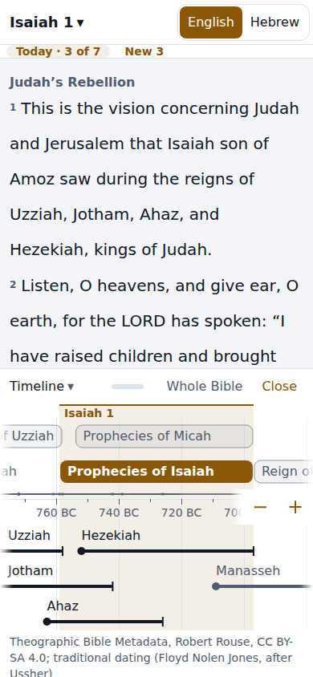 |
| Zoomed out: `Whole Bible` pressed, 4004 BC to AD 100, Isaiah 1 a thin amber column | 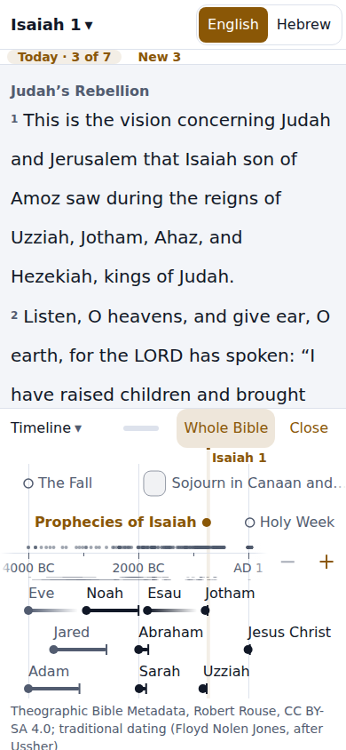 |
| An event's card: the strip makes room above it and rings the event | 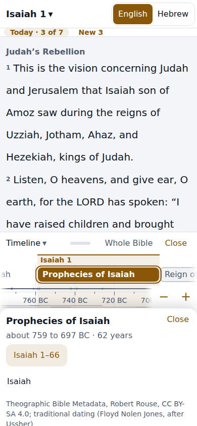 |
| Dark | 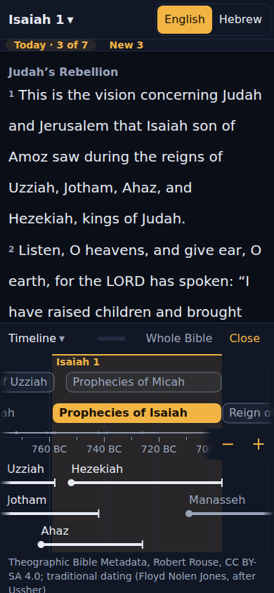 |
| A person's card, from a tap on a life | 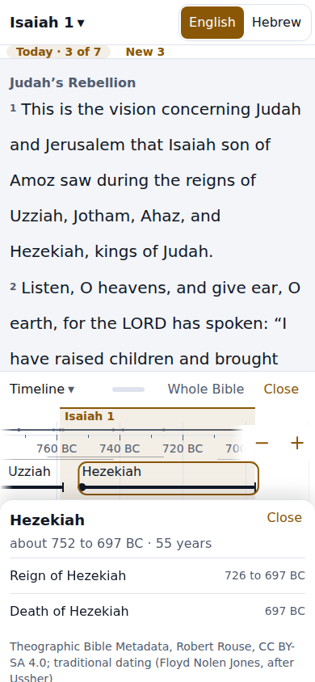 |
| Away from the chapter (David's years): its name at the side it lies on | 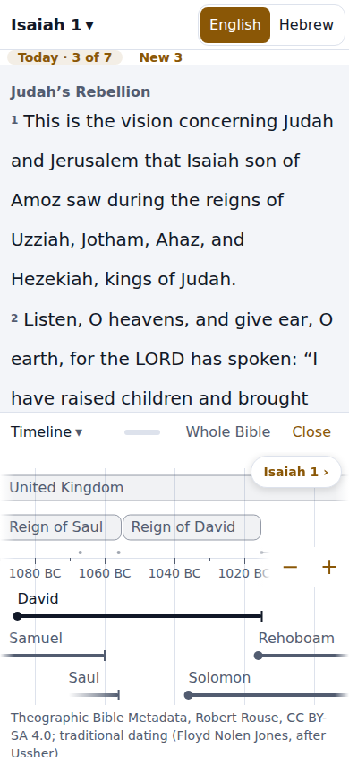 |
| A tap on the ruler where it is busy: the list of what found no lane | 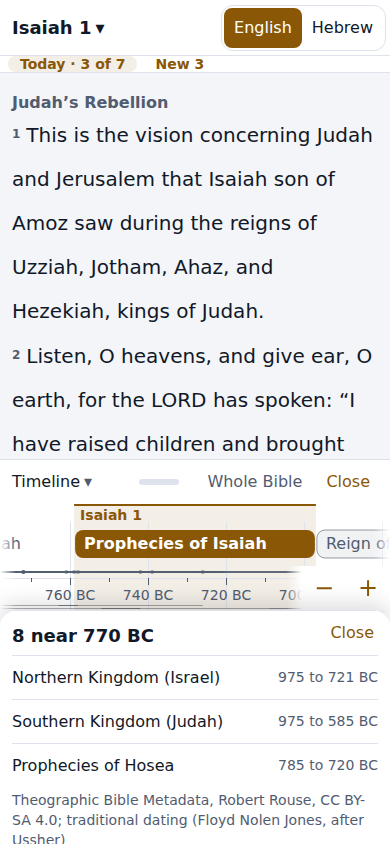 |
| Crowded: Luke 23, AD 30, the busiest year of the data, zoomed to days | 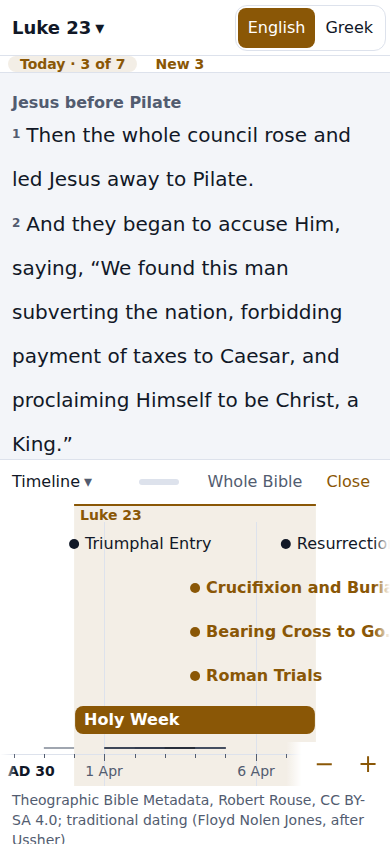 |
| Genesis 5 (dark): the chapter's lives, six by name in three lanes, the rest on the ribbon | 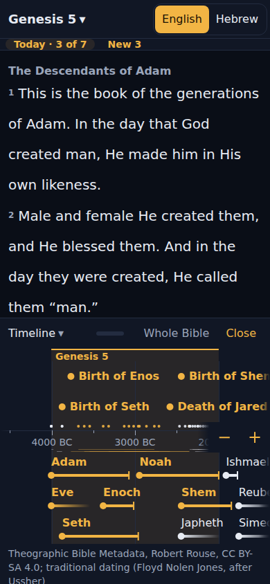 |
| The dock pulled small: the chapter's name, one lane, the ruler | 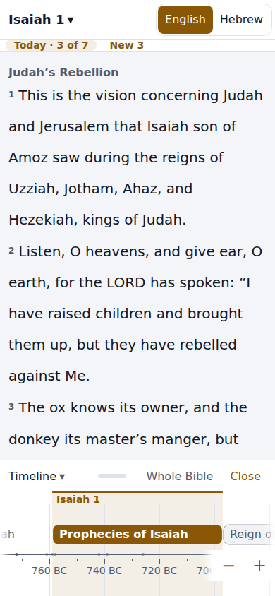 |
| Sideways (844x390) | 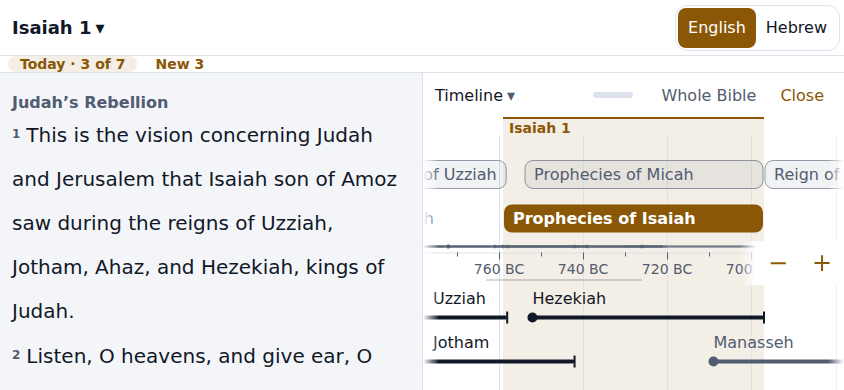 |
| Wide (1024x768): nine lanes of events | 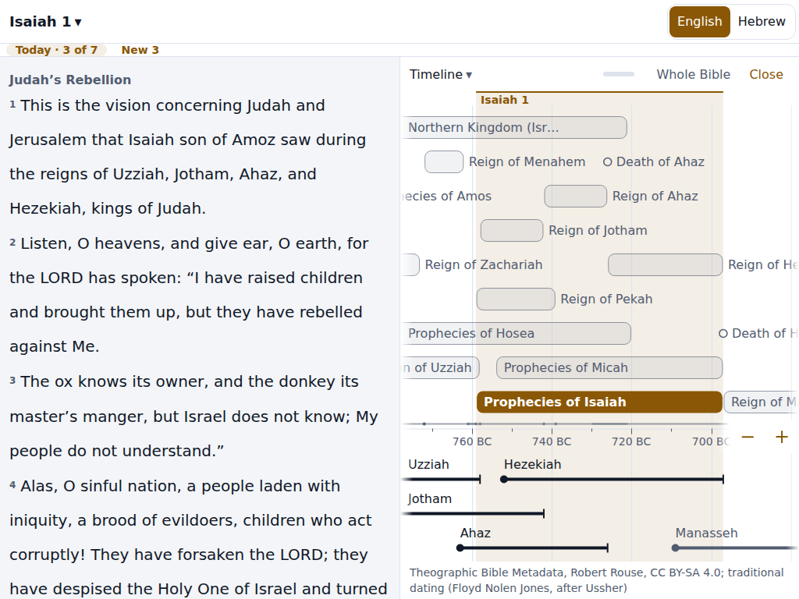 |

## Layout

The strip is the body of the Reader's dock (`src/reader/split/Dock.tsx`), so the dock's own rules stand: the 44 px handle row is the divider, the body scrolls on its own, the
size is his and is kept as a fraction. At 390x844 the box under the chips is 748 px and the dock opens at Half, 374 px: the 44 px row and a 330 px body in a browser tab, a 282 px
body in the installed app, where the phone's bar keeps 48 px at the foot (`--lp-bar-inset`).

**The handle row** reads `Timeline ▾` at the left (the chooser, as a text's name), the pill, then `Whole Bible` where a text has `Link` (a button with `aria-pressed`, drawn as
`Link` is: muted when off, amber on a tint when on), then `Close`.

**The body**, top to bottom, scrolling up and down as a map's body does:

1. the strip: one picture, `STRIP_FULL` tall while the body has that much, growing with a taller body, never under `STRIP_MIN` (the dock's smallest body for a timeline: T2 passes it to `boundsOf` as a map passes its credit row);
2. the credit line the data asks for (`TIMELINE_CREDIT`, three lines of 14 px at 390 px), the first thing under the strip. Its height is the strip's to give: `strip = max(STRIP_MIN, min(body, max(STRIP_FULL, body - credit)))`, so on the installed phone at Half the strip has all five lanes and the credit is one small scroll down, and from a 350 px body up the credit is in view whole (decision D2);
3. `Timeline at Bible Mapper`, the link the maps already have, here opening Bible Mapper's own timeline at the year in the middle of the strip (`?date=<signed year>`).

**The strip**, top to bottom:

```
 ┌ Isaiah 1 ───────────────┐                    FLAG 18   the chapter's name, on its column
 │  [ Reign of Uzziah ][ Prophecies of Micah ]  LANE 44   events, the lane furthest from the ruler
 │  [ Prophecies of Isaiah ]                    LANE 44   events, the lane next to the ruler: the chapter's own first
 ·  · ·· ·     ·    ·                           SPINE 44  ribbon, the line, ticks, years; − and + at its right end
 │ 760 BC   740 BC   720 BC           [−][+]
 │ Uzziah ──┤  Hezekiah ●───────────┤           LANE 44   lives, the lane next to the ruler
 │ Jotham ──────┤                               LANE 44
 │      Ahaz ●────────┤                         LANE 44
```

| Constant | Value | What it is |
| --- | --- | --- |
| `LANE` | 44 | a lane of events or of lives, px: a thumb tall |
| `SPINE` | 44 | the ruler between them: the ribbon of what has no lane, the line, the ticks, the years |
| `FLAG` | 18 | the room at the top for the chapter's name |
| `STRIP_MIN` | 106 | the least strip: the name, one lane, the ruler |
| `STRIP_FULL` | 282 | the strip with five lanes |
| `BAR` | 28 | an event's bar, in the middle of its lane, corners of 8 px |
| `DOT` | 10 | an event of one day: a dot (a ring for another book's) |
| `LIFE` | 4 | a life's line: a dot at the birth, a 2 by 12 px tick at the death |
| `TARGET` | 44 | the least width the lanes give any mark |
| `LABEL_MAX` | 200 | a title wider than this is cut with an ellipsis (the card has it whole) |
| `GAP` | 8 | between two marks of a lane; none after a bar that holds its own title, so a reign that ends the year the next begins shares its lane |
| `TICK_GAP` | 72 | the least distance between two written years |
| `HOME_SHARE` | 0.62 | the share of the width the chapter's years take when the strip opens |
| `PEOPLE_SHARE` | 0.6 | lives never take more than this share of the lanes |
| `EDGE_FADE` | 16 | the fade at each side, where time goes on |
| `WHOLE_PAD` | 32 | the room left of 4004 BC in the widest view, so the first year is written whole |
| `ZOOM_BOX` | 104 | the room right of AD 100 in the widest view: the zoom buttons and their fade never cover AD 1 |
| `DPR_MAX` | 2 | the picture is drawn at no more than two device px to one |
| `DAY_PX` | 48 | the closest zoom: one day this wide |
| `SUIT_EVENT` | 120 | among other books' events, the bar nearest this width chooses a lane first |
| `SUIT_LIFE` | 160 | the same for other books' lives |

**Where it opens.** On the chapter's time: from the first start to the last end of the events that have a verse in the chapter, taking `HOME_SHARE` of the width, in the middle. A
span under a year opens as a year; where every event of the chapter has a day (Luke 23) it opens on those days. A chapter with no event opens on its book's span; a book with none
opens on the whole Bible, with no column (tried: 3 John), and the handle row's name says quietly `No dates for 3 John`, as a chapter with no map says `No map for Genesis 15` (the row's words are T2's: the prototype's row is a stand-in).

**How the lanes are dealt.** The strip has `floor((height - FLAG - SPINE) / LANE)` lanes. Lives take what the lives in view need, never over `PEOPLE_SHARE` of the lanes and always
leaving events one; events take the rest (`dealLanes`). At 282 px that is two of events and three of lives at Isaiah 1, and five of events at Luke 23, where no dated life is in
view and the ruler drops to the foot. The lanes are dealt again only when the strip comes to rest, never under the finger, and marks ease to their new lanes.

**What is drawn** (decision D1): every book's events and every dated life (501 events and 86 lives in the whole Bible), the open book's file at once and the other 64 after the
first picture. A `Lifetime of ...` event of a person who has both years is that person's line, drawn once, among the lives. A person with no year (Isaiah himself) has no line: he is
in his events' cards.

**Sideways and wide.** At 844x390 and from 768 px wide the dock stands at the right (the dock's own rule) and the strip is the same picture in a box about 420 px wide: at
844x390, two lanes of events and two of lives. On a tablet the lanes simply go on: at 1024x768 nine lanes of events over three of lives. Nothing changes shape; there is one layout,
dealt from the box.

## Type

Two sizes and the app's own face, so the strip reads as the dock's handle row does.

| Constant | Value | What it is |
| --- | --- | --- |
| `TITLE_PX` | 16 | an event's title and a person's name (`text-base`, weight 500; 600 for the chapter's own) |
| `SMALL_PX` | 14 | the years on the ruler, the chapter's name on its column (weight 600), the credit (`text-sm`) |

- The face is `--font-sans`, so it follows Settings > Appearance > Font, read from the strip's own computed style; the picture is drawn again when a font finishes loading.
- Years are written as the maps write them (`src/maps/period.ts`): `759 BC`, `AD 30`; there is no year 0, so the ruler's round years are the written ones (`500 BC`, never `501 BC`), and `AD 1` is always written where the turn is in view. Zoomed in, the ruler steps in months (`Apr`, the year at January) and then days (`3 Apr`), and the year stays written at its left end.
- A title that fits in its bar is inside it, and slides to stay in view while its bar leaves by the left. A name rides its life's line the same way. A title that would be cut by the end of the Bible's time stands before its mark instead, so the New Testament's titles are whole in the widest view.
- The card is ordinary page text: title 18 px weight 600 (`chrome-title`'s size), the date and rows `text-base`, a row's years `text-sm`.
- Not tried in the prototype: the Text size setting. The rule for T2: the picture's type takes the setting up to 130%, where a 16 px title is still inside its 28 px bar; the lanes stay 44 px, as the app's tap heights do; the card, being page text, takes it all.

## Colour

Only the app's tokens (`src/index.css`), read from the strip's computed style and read again when the theme changes, so Sepia and High contrast draw from their own tokens with
no code of their own (not rendered here: T2 looks at both).

| Token | Dark | Light | On the strip |
| --- | --- | --- | --- |
| `--lp-surface` | #111725 | #ffffff | the ground, the card |
| `--lp-canvas` | #0a0e17 | #f3f5f9 | not used by the strip (the passage's ground) |
| `--lp-line` | #232c40 | #dde2ec | the ruler's line, a hairline down the strip at each written year, borders |
| `--lp-fg` | #e7ebf3 | #111827 | the open book's events and lives; the card's words |
| `--lp-muted` | #9aa5ba | #525c70 | the other books' events and lives; the years; the credit |
| `--lp-accent` | #f2b544 | #8a5706 | the open chapter's events and lives; its column (10%) and name; buttons; the ring round the chosen mark |
| `--lp-accent-fg` | #1a1204 | #ffffff | a title inside a chapter's bar |

The three voices differ in shape as well as colour: the chapter's bar is solid, the book's is a 10% tint with a 3 px bar of ink at its start, another book's is an outline; the
chapter's and the book's days are dots, another book's a ring. Contrast, worked out from the tokens (docs/accessibility.md asks 4.5:1): the least pair is a grey title on a grey bar
over the chapter's column, 5.2:1 in both themes; ink on the ground is 17.7:1 light and 15.0:1 dark, grey 6.7:1 and 7.2:1, amber 6.1:1 and 9.8:1, a title inside an amber bar 6.1:1
and 10.1:1.

## Motion

The strip moves the way a list on the phone moves, and it is never animated for its own sake: it runs frames only while a finger is on it or it is settling, and none at rest.

| Constant | Value | What it is |
| --- | --- | --- |
| `GLIDE_MS` | 325 | the time constant of a fling's decay: let go at v px/ms, the strip comes to rest v x 325 px further on |
| `SPEED_WINDOW_MS` | 100 | the finger's speed is read over its last 100 ms (the page turn's own); a finger that stopped before lifting throws nothing |
| `FLING_MIN` | 0.05 | px/ms: slower than this is not a fling |
| `FLING_MAX` | 6 | px/ms: no fling is faster |
| `SNAP_PX` | 28 | a glide or a let-go that would rest this near the chapter settles on it |
| `RUBBER` | 0.35 | past an end of the Bible's time, or of the zoom, the strip follows 0.35 of the finger (the chapter swipe's `FOLLOW_SHARE`) |
| `SPRING_MS` | 200 | back from past an end, a settle on the chapter, an arrow key's move: the bars' own 200 ms |
| `ZOOM_STEP` | 2 | one tap of `−` or `+`, one press of - or + |
| `ZOOM_MS` | 240 | a zoom step |
| `FLY_MIN_MS` | 240 | a flight takes from this |
| `FLY_MAX_MS` | 640 | to this, by how far it goes |
| `TAP_SLOP` | 8 | px: a finger that moves less is a tap (the ladder graph's own) |
| `EDGE_PX` | 24 | no pan starts this near a side of the screen: that is the phone's Back swipe (the chapter swipe's own) |
| `PAN_STEP` | 0.4 | an arrow key, `Earlier` or `Later`, moves this share of the width (the ladder graph's own) |
| `EASE_MS` | 120 | a mark changing lane, a name coming or going |
| `CARD_MS` | 200 | the card rising |

- **Under the finger.** A drag moves time one to one from the 8th px. Sideways is the strip's; up and down are the page's (the dock's body scrolls to the credit), told apart as the Reader tells a chapter swipe from a scroll: `touch-action: pan-y`, and a pan that has taken hold holds the fingers (a `touchmove` that is not passive, docs/pwa-best-practices.md).
- **Momentum.** Let go moving and the strip glides: fast at first and slowing, most of the way in the first half second and at rest within about two (`rest - (rest - from) * e^(-t / GLIDE_MS)`), as a flung list is. A finger on a gliding strip catches it at once.
- **Snap to the chapter.** Where the glide would end is known the moment the finger lifts. If that is within `SNAP_PX` of the chapter's place, the glide is aimed at the chapter instead, so it arrives there in one motion with no second move; a slow let-go that near it settles on it in 200 ms. As a glide lands there the phone gives the hold's own 10 ms tick (decision D4). The snap is off while the chapter's column is wider than the strip, or the zoom is over one and a half times closer or further than the opening one. So the chapter is a place the hand finds without aiming, and never a place it cannot leave: 29 px is away.
- **Zoom.** Two fingers zoom about the place between them, one to one with their spread; ctrl and the wheel (a trackpad's pinch) about the pointer; `−` and `+` at the ruler's end about the middle, doubling or halving in 240 ms. From the whole Bible in the width to a day 48 px wide is 18 doublings, so a pinch alone would be work: the buttons and the flights do the long hauls. Past either end the zoom gives like rubber and comes back.
- **Flights.** `Whole Bible`, the chapter's name at the side, the Home key, a row of a list and a chapter change all fly: van Wijk and Nuij's smooth zoom-and-pan (the path of d3's `interpolateZoom`), in one dimension. Going far it draws back, crosses and closes in, so the eye keeps its place; near, it is a plain zoom. `Whole Bible` pressed again flies back to where he was.
- **The lanes ease.** Zooming changes which marks have room. A mark changing lane slides there, a name fades, a mark losing its lane fades into the ribbon, over `EASE_MS`; nothing pops.
- **Reduced motion.** Under `prefers-reduced-motion` there is no momentum, no flight, no easing and no card slide: the strip follows the finger and everything else happens at once. The snap still applies, as a plain set.

## Crowding

Real figures: AD 30 has 46 events, 187 fall between AD 1 and 57, and nine lives of Genesis 5 overlap. The strip never stacks marks on each other and never shrinks type.

- **Every mark gets a thumb or nothing.** The lanes are packed from each mark's reach with its name, never narrower than `TARGET`: so two marks of a lane are never closer than a thumb, and nothing stands in a lane unnamed. The packing is in the strip's own coordinates at a zoom, so a pan never changes it: names do not jump while he drags.
- **Who chooses first.** The chosen mark (its card is open); then the open chapter's; then the open book's; then the rest, spans before single days, the span nearest `SUIT_EVENT` wide at this zoom first (reigns and fellow prophets beside a prophet; kingdoms and the sojourn beside the whole Bible), and a bar that holds its own title before one whose title must stand beside it. Within a kind, the earlier.
- **The ribbon.** What finds no lane is a 4 px dot (a span: a 2 px line) on the ribbon over the ruler's line, and for lives a hairline under the years: where the ribbon is dark, time is full. The ruler there is one button a thumb wide; one mark under it opens that mark's card, several open a list (`8 near 770 BC`) in the order they would have chosen lanes, and a row flies to its mark and opens its card.
- **More room is his to take.** `+`, a pinch, or the dock pulled taller: each gives lanes back. The dock's free divider is the timeline's own answer to a crowded year.
- Single-day events never become bars, however far in: a day is the data's smallest grain. Same-day events fill the lanes in the order above and the rest are the list.
- For people: a life whose birth or death the data does not give fades out over 56 px at that end. The lives are few (86), so the three lanes of a half dock hold a generation; Genesis 5, where the patriarchs' lives overlap nine deep, shows six by name in its three lanes (the chapter's first) and the rest on the ribbon until the dock is taller.

## Touch targets

Nothing a thumb is asked to hit is under 44 px either way (`--lp-tap`): a lane is 44 px tall and the packer gives every mark 44 px of width of its own; the ruler's ribbon buttons
are 44 px tall (the spine) and at least 44 px wide; `−` and `+` are 44 by 44 px; the chapter's name at the side is 36 px tall with a 44 px reach; the card's `Close`, verse chips,
people and rows are 44 px tall. At rest each of these is a real `<button>` laid over the picture, with a name (`Prophecies of Isaiah, about 759 to 697 BC`), a focus ring and the
pressed tint, so the tap guard, a keyboard and TalkBack meet ordinary buttons. While the strip moves the buttons are hidden and a tap only catches it, as a tap stops a moving
list.

## Gestures

A gesture is never the only way (docs/accessibility.md 'Gesture-only actions': T2 adds these rows there, and `tests/unit/gesture-only-doc.test.ts` then holds the names).

| Gesture | What it does | The button or key that does the same |
| --- | --- | --- |
| A drag left or right on the strip | moves through time, one to one | `Earlier` and `Later` (`src/ReaderControls.tsx`, shown while focused); the Left and Right arrows on the strip |
| Letting go while moving | a glide, settling on the chapter when it would rest near it | the same; the Home key and the chapter's name fly to the chapter |
| Two fingers spread or closed (ctrl and the wheel) | zooms about the place between them | `Zoom in` and `Zoom out`, the `+` and `−` at the ruler's end; the + and - keys |
| (the long way out and back) | the whole Bible, and back to where he was | `Whole Bible` on the handle row, a pressed button |
| A tap on an event or a life | opens its card | it is a button, named by its title and years |
| A tap on the ruler where the ribbon has marks | lists what found no lane | it is a button, named `8 near 770 BC` |
| A tap on the chapter's name at the side | flies back to the chapter | it is a button (`‹ Isaiah 1`); the Home key |
| A drag up or down on the strip | scrolls the dock's body to the credit and the link | the page's own scroll; Tab reaches the link |
| A drag of the handle row | sizes or closes the dock (the split's own) | `Larger split`, `Smaller split`, `Close the split`, `Close` |

No double tap, no hold and no two-finger tap do anything on the strip (it carries `data-two-finger`, so a pinch is never read as the Immersive reader's two-finger tap).

## The card

A tap on an event raises its card from the strip's foot, inside the dock, in `CARD_MS` (the sheets' own rise of 24 px). The strip makes room: it deals its lanes again for the
height left above the card, keeps the chosen mark in a lane whatever the crowd, and rings it in amber. So the card and what it speaks of are seen together, with no arrow to draw
and nothing covered that matters. The card is never taller than the strip less `STRIP_MIN`; longer, it scrolls.

- **An event**: its title; `about 759 to 697 BC · 62 years` (`about` wherever the data gives a year and no day; a day as `1 May AD 30`; the length in the data's own units, nothing for a single day); its verses as chips, the open book's first, a run of whole chapters as one (`Isaiah 1–66`), any other as `2 Kings 18:1–8`; its people, a dated one as a quiet chip, an undated one as plain words.
- **A verse chip** moves the text: to the range's first verse, or, when the range holds the open chapter, to its first verse of that chapter (the chip is then tinted and `aria-current`). A chip of another chapter or book opens that chapter by the Reader's own way in, and the strip flies to its time.
- **A life**: the name; `about 752 to 697 BC · 55 years` (`born about 1754 BC` where only one year is known); the events the person takes part in, as rows that open them.
- **A list** (from the ruler): `8 near 770 BC` and a row for each, title and years.
- `Close` and Escape shut it; a tap on another mark changes it. The chips wrap; nothing in the card scrolls sideways.

## Rendering

**Chosen: one 2D canvas for the picture, real DOM over it for everything read, pressed or announced. No WebGL.**

The budget is 60 fps on a mid phone: 16.7 ms a frame, of which the strip's own work (lanes, easing, drawing) may take half, 8 ms on average, and never a whole frame; and no frame
at all at rest. Measured on the prototype with `node prototypes/timeline/render.mjs --bench` (2026-11-25, Playwright 1.63.0's headless Chromium on the desktop host, software drawing, the
processor slowed four times, the phone's 390 px width at two device px to one; each frame ends by reading a pixel back, so the drawing is inside the time):

| The strip's work in a frame | Marks | Pan: mean | 95th | worst | Zoom: mean | 95th | worst |
| --- | --- | --- | --- | --- | --- | --- | --- |
| Isaiah 1, the whole Bible loaded | 560 | 3.27 ms | 4.50 ms | 7.20 ms | 5.23 ms | 8.00 ms | 8.70 ms |
| Luke 23, AD 30, the busiest year | 560 | 1.93 ms | 3.40 ms | 5.30 ms | 4.95 ms | 7.30 ms | 9.00 ms |
| every event drawn ten times | 4,826 | 8.92 ms | 12.60 ms | 32.30 ms | 27.13 ms | 51.10 ms | 52.80 ms |
| every event drawn forty times | 19,046 | 30.73 ms | 35.50 ms | 84.70 ms | 110.43 ms | 206.90 ms | 230.80 ms |

A real flight out to the whole Bible and back, on the screen's own frames, same slowing: at Isaiah 1, 68 frames a median 16.7 ms apart (95th 20.9 ms, worst 23.1 ms), the strip's
work in them 3.37 ms on average and 7.20 ms at worst; and no frame in two seconds at rest. At Luke 23 (from a day out to forty-one centuries) the median is 17.0 ms but the 95th is
36.6 ms and the worst 40.8 ms, while the strip's work in those frames is 3.56 ms on average and 8.40 ms at worst: the late frames are not the strip's script. What they are was not
found here (a headless browser draws without a graphics card); it is the first thing T2 measures on the built app and on the phone.

Why this and not the others:

- **Not DOM alone.** A zoom is not a scaling of the picture (type must not stretch), so each frame of a pinch would move and resize every mark's element and measure names for the lanes: style, layout and paint of hundreds of nodes a frame, where the canvas is one bitmap and reads no layout. Reasoned, not measured. DOM is kept for what it is best at: at rest every mark in view is a real button, the card is page text, a live region says where the strip stands (`780 to 680 BC, Isaiah 1`).
- **Not WebGL, because it would buy nothing here and cost the type.** The whole Bible is 560 marks. A pan (drawing only) is 3 ms; a zoom (drawing and the lanes) 5 ms. With ten times the data a pan is still 9 ms but a zoom is 27 ms: what breaks first is the lanes, which is arithmetic that WebGL does not touch. And the picture is mostly names: in a 2D canvas they are the app's own faces, in the chosen Font, at any size, Greek and Hebrew shaped by the browser; in WebGL they would be a glyph atlas kept for each face, weight and size. Lampas does use WebGL where it earns its place, for the page curl (`src/reader/pageCurl.ts`), which bends a picture, a thing a 2D canvas cannot do. A flat strip of bars, lines and names is what a 2D canvas is for.
- **When that would change**: tens of thousands of marks in view at once, or an effect a 2D canvas cannot draw. Neither is in the data or the design.

What keeps the canvas cheap, for T2 to keep: frames are asked for only while something moves; a pan reuses the lanes (they are packed per zoom, in the strip's own coordinates);
names are measured once and kept; no gradient is made in a frame but the two edge fades and a life's faded end; the bitmap is at most two device px to one (`DPR_MAX`); nothing in
a frame reads the page's layout, and the only writes to the page happen at rest.

## The budget check

What T2 and T3 mean by "holds 60 fps on the design's budget check". T2 writes it as `tests/e2e/timeline-budget.spec.ts`, on the built app at 390x844 and two device px to one,
with the processor slowed 4x (CDP `Emulation.setCPUThrottlingRate`, the usual stand-in for a mid phone), through one hook the strip gives a test (the prototype's
`bench(240)`: 240 frames of a pan across six widths at the chapter's zoom, then 240 of a zoom from the chapter out to the whole Bible and in to a day, each frame the strip's whole
work, ending with a pixel read back):

1. At Isaiah 1 and at Luke 23, with every book loaded: the strip's work is at most 8 ms a frame on average and at most 12 ms at the 95th frame, panning and zooming. The worst frame is written to the log and held under 16.7 ms only on a quiet host (a loaded gate host makes one frame late without the strip's doing).
2. At rest the strip runs no frame: after a flight has landed and a second has passed, the frame count does not move for two seconds.
3. The same two with a card open (T3).
4. Once, by hand, on the Governor's phone: the prototype with `?hud=1` (each frame's work in ms, on the screen), a fling and a pinch at Luke 23. This is the only measure of the phone itself; the closing comment says what it read.

The prototype's own run of these is the table above; `node prototypes/timeline/render.mjs --check` runs the gestures in a browser (17 checks, motion on) and
`tests/unit/timeline-design.test.ts` the maths.

## Not done

- No WebGL, because the whole Bible is 560 marks and a 2D canvas draws them in 3 to 5 ms with the processor slowed four times (Rendering, above).
- No strip that runs up and down, because he chose left and right (Q2 of the grilling).
- No double tap to zoom, because Lampas has no double tap anywhere and its tap guard drops a second tap; `+` is the one-handed zoom.
- No hold on the strip, because a hold speaks or copies elsewhere in Lampas and would mean a third thing here.
- No unnamed mark in a lane, because a bar or a dot with no name is a riddle; it waits on the ribbon until its name has room.
- No eras of our own behind the strip, because the data already tells the kingdoms and the sojourn as events, and a period the app made up would not be Theographic's or carry its credit.
- No places on the strip, because the strip is time; an event's places can join its card when a story asks (the data has them).
- No line for a person with no year, because a life with no date has no place on a ruler; such a person is in the cards.
- No sideways scroll inside the card, because two things that move sideways in one pane fight for the same drag; the chips wrap.
- No `Link` button, because the strip always follows the chapter (T3's third criterion) and a second state would have to be learned.
- No Back step for the card or the strip, because the split is a layout that Back never closes (docs/design/reader-split.md D3) and the card is part of it; `Close` and Escape shut it.
- No remembering of where the strip was panned or zoomed, because it opens at the chapter's time (his words); only that the dock holds the timeline is kept, as `splitMap` is.
- No search and no jump to a typed year, because nothing asked for it and the ruler, the flights and Bible Mapper's link cover it.
- No picture kept between frames (tiles, a wider bitmap to slide), because a whole frame costs 3 ms and a kept picture would have to be thrown away at every zoom.

## Decisions

Four, each A or B with the recommended one; the prototype is built on the recommended ones.

### D1 What the strip draws beyond the open book

- A: Every book's events and every dated life, the open chapter's amber, the open book's ink, the rest grey: the open book's file first, the other 64 (182,383 bytes of JSON in all) once the strip has drawn. Isaiah's own file has one event; with the rest, Isaiah 1 stands among Micah, Hosea and the kings.
- B: Only the open book's file: less to load and nothing grey, but Isaiah is one bar on an empty ruler, and time has nothing in it once he drags away.
- Recommended: A. A timeline's worth is what stands beside the thing you are reading.

### D2 Where the credit line stands

- A: The first thing under the strip, in the dock's own scroll, as Bible Mapper's credit is under a docked map: in view whole from a 350 px body up, part in view from 283 px, one small scroll down on the installed phone at Half, where the strip keeps its five lanes.
- B: Always in view: the strip gives up 68 px at every size, which at Half on the installed phone is two of its five lanes (the kings of Isaiah 1 no longer all fit).
- Recommended: A. The line is with the data in the same pane, as on the maps; B is one constant (`STRIP_FULL` set to `STRIP_MIN`) if he wants it always seen.

### D3 The zoom's buttons

- A: `Whole Bible` on the handle row and `−` `+` at the right end of the ruler, always seen: one hand can zoom, and the long way out is one tap.
- B: `Whole Bible` alone, with `Zoom in` and `Zoom out` among the Reader's controls shown while focused: a cleaner ruler, but a one-handed reader cannot zoom a step.
- Recommended: A. He reads one-handed; a pinch needs two.

### D4 The tick as the strip settles on the chapter

- A: The hold's own 10 ms vibration (`src/ui/longPress.ts`) when a glide lands on the chapter by the snap: the hand feels it arrive. Android only; nothing where the phone has no vibration.
- B: No tick: the snap is seen, not felt.
- Recommended: A.

## For the build stories

What each takes from here, each item with how it is checked. The pure half of the prototype (time, ruler, motion, lanes: the exports of `timeline.js` above `mount`) is written to
be carried into `src/timeline/` as TypeScript nearly as it stands, its numbers as named constants.

### mw-fnvjof.17.317.2 The dock and the strip

1. The pure parts live in `src/timeline/` (the axis with no year 0, the ruler's ticks, the opening view, glide, snap, flight, the dealing and packing of lanes) with the constants of this page's tables, and the cases of `tests/unit/timeline-design.test.ts` 'the prototype' pass on them (unit test).
2. At 390x844 with the timeline docked at Half, Isaiah 1: the handle row reads `Timeline`, `Whole Bible` (not pressed) and `Close`; the strip is 282 px tall with the credit line under it; the chapter's column takes 62% of the width within 2 px, in the middle; `Prophecies of Isaiah` and the four kings each have a button over the picture (e2e, tests/e2e/timeline-dock.spec.ts).
3. A drag of 80 px moves the strip 72 px and stays; a slow drag of 20 px settles back on the chapter; a fling goes on after the finger lifts and comes to rest; with the chapter out of view `‹ Isaiah 1` or `Isaiah 1 ›` stands at its side and flies back (e2e; the prototype's `--check` is the pattern).
4. A pinch of two fingers (CDP touch) zooms about the place between them; `Zoom in` and `Zoom out` double and halve and carry `data-repeat`; `Whole Bible` flies out, is pressed, and pressed again flies back to where he was (e2e, `hasTouch`).
5. A drag up the strip scrolls the dock's body to the credit and `Timeline at Bible Mapper`, whose address carries the year in the middle of the strip; a drag in the dock never turns the chapter (e2e).
6. `Earlier`, `Later`, `Zoom in`, `Zoom out` are reachable with no gesture, the arrows, + and -, and Home work on the focused strip, and docs/accessibility.md's table has the rows (unit test, tests/unit/gesture-only-doc.test.ts; e2e, tests/e2e/no-gesture-only.spec.ts extended).
7. Under reduced motion a let-go does not glide and `Whole Bible` arrives at once (e2e, `reducedMotion: 'reduce'`).
8. The strip draws from the theme's tokens: Light, Dark, Sepia and High contrast each pass the axe check of docs/accessibility.md with the dock open (e2e).
9. The budget check, items 1 and 2 of 'The budget check' (e2e, tests/e2e/timeline-budget.spec.ts).
10. The dock's smallest body for a timeline is `STRIP_MIN`; the strip's height follows `max(STRIP_MIN, min(body, max(STRIP_FULL, body - credit)))` (unit test on the sum; e2e at the smallest size).
11. Screenshots at 390x844 of the same states as this page's first four pictures, in the closing comment (gate: the `shots` project).

### mw-fnvjof.17.317.3 The card, the verse tap, following the chapter

1. A tap on `Prophecies of Isaiah` raises the card with the title, `about 759 to 697 BC · 62 years`, the chip `Isaiah 1–66` (tinted, `aria-current`) and `Isaiah` as plain words; the strip above it keeps the event in a lane with the ring; `Close` and Escape shut it and the lanes come back (e2e, tests/e2e/timeline-card.spec.ts).
2. An event with a day (Acts 1, `The Holy Spirit is promised`) reads `1 May AD 30` with no `about`; a single day shows no length (unit test on the date's words; e2e).
3. A verse chip of the open chapter moves the text to that verse; a chip of another chapter or book opens it and the strip flies to its time (e2e).
4. Moving to the next chapter with the strip dragged away flies it to the new chapter's time and moves the column and its name (e2e).
5. The sweep of taps: a life opens the person's card (name, years, the events as rows that open them); the ruler where the ribbon has several marks opens the list, and a row flies to its mark and opens its card; the chapter's name at the side flies back (e2e, each listed in the closing comment).
6. The verses' chips are worked out purely from the ranges (a run of whole chapters is one chip) (unit test).
7. The budget check, item 3, with a card open (e2e, tests/e2e/timeline-budget.spec.ts).

## The other strips and gestures

Every other surface of Lampas with a sideways strip or a gesture, and whether this design keeps to its gestures and type (read from the source on 2026-11-25).

| Surface | Its gestures and type | The timeline |
| --- | --- | --- |
| The dock's handle row (`src/reader/split/Dock.tsx`, `useSplit.ts`) | a drag along the split, 4 px of slop, 80 px past the smallest closes; 44 px row; `text-base font-medium` | Keeps: it is that dock and that row, with `Whole Bible` where a text has `Link`, drawn as `Link` is. The strip's titles are the row's 16 px medium. |
| The chapter swipe (`src/reader/useChapterSwipe.ts`) | left and right on the passage turn the chapter: 60 px in 600 ms, follows 0.35 of the finger, nothing within 24 px of an edge, `touch-pan-y` | Keeps: the dock is beside the passage, not in it, so a drag on the strip never turns the chapter; the strip takes the same `pan-y`, the same 0.35 past an end and the same 24 px at the edges. |
| Turn pages (`src/reader/usePages.ts`, `pageTurn.ts`) | a drag the page follows, a flick at 0.5 px/ms read over 100 ms, taps in the outer thirds, a WebGL curl | Keeps: the same 100 ms window for the finger's speed. Differs: a page turns or springs back, time glides on and stops where it stops, because it has no pages. |
| A map (`src/maps/MapView.tsx`) | a tap toggles fit and twice the width, the box's own scroll pans, pinch where the phone allows; `data-two-finger`; credit `text-sm text-muted`, links `text-base` amber underlined | Differs: the strip zooms without steps and moves itself, because a ruler 18 doublings deep cannot be a picture in a scrolled box. Keeps: the credit under the picture in the body's scroll in the map's type, the link's look, `data-two-finger`. |
| The ladder graph (`src/LadderGraph.tsx`) | one finger pans, two pinch, the wheel zooms, arrows move 40% of the box, + and - zoom by 1.25, 8 px of slop, `touch-none` | Keeps: the 8 px, the 40%, the pinch about the place between the fingers, a focusable group with keys. Differs: + and - double (18 doublings at 1.25 a press is too many presses), and `pan-y` not `touch-none`, because the dock's body scrolls under the strip. |
| The bottom sheets (`src/ui/sheetDrag.ts`) | a pull down of 80 px on the handle row closes; a sheet rises 24 px in 240 ms | Keeps: the card rises 24 px as a sheet does, in the bars' 200 ms. Differs: the card has no drag to close, because a drag down on the strip scrolls the dock's body. |
| The chips row and the other sideways scrollers (`src/ReaderChips.tsx`, `src/LessonStrip.tsx`, `src/VerseView.tsx`, `src/ParadigmsScreen.tsx`, `src/diagram/ReedKellogg.tsx`) | the browser's own sideways scroll, with a fade and a cut chip to show there is more (`src/ScrollMore.tsx`) | Differs: the strip is not a scroll box (it zooms), so it shows there is more its own way: a 16 px fade at each side and the chapter's name at the side it lies on. The card's chips wrap, so the pane has one thing that moves sideways. |
| The hold (`src/ui/longPress.ts`) | 500 ms on a word, a verse number, a heading: speak or copy; a 10 ms tick | Keeps: no hold on the strip; the tick is borrowed for the snap (D4). |
| The Immersive reader's two-finger tap (`src/immersive.ts`) | two fingers down and up toggles the bars, except in a box marked `data-two-finger` | Keeps: the strip is so marked, so a pinch never toggles the bars. |
| The tap guard (`src/ui/tapGuard.ts`) | a second tap on the same control inside the settle time is dropped unless it carries `data-repeat` | Keeps: `−` and `+` step a value and carry `data-repeat`; every other target is tapped once. |

## The prototype

`prototypes/timeline/` is static files, never in the build: `index.html` (a stand-in of the Reader and the dock, drawn from the app's tokens by hand), `timeline.js` (the strip:
its pure half, then `mount`), `serve.mjs` (serves the repo's own files, since a page opened from the disk cannot read them) and `render.mjs`. It reads
`src/timeline/data/<book>.json` as the import wrote them, the credit line with them, and the passage from `public/data/`; no data is copied into it.

```bash
node prototypes/timeline/serve.mjs          # then open http://127.0.0.1:4317/prototypes/timeline/
node prototypes/timeline/serve.mjs --lan    # also prints the address for the phone on the same network
node prototypes/timeline/render.mjs         # the pictures of this page, into docs/timeline-design/ (after npm ci)
node prototypes/timeline/render.mjs --check # the gestures, each run in a browser with motion on: 17 checks
node prototypes/timeline/render.mjs --bench # the budget's figures
```

`?book=luk&chapter=23` opens any chapter; `?theme=dark` or `light`; `?hud=1` writes each frame's work on the screen; the page's first comment lists the rest. Dragging the handle
row sizes the dock. A verse chip of another chapter opens that chapter in the prototype.

What the prototype is not: the app. Its Reader is a stand-in (no word taps, no chips, no settings); the Text size setting, Sepia and High contrast, TalkBack and the installed
phone's bar are T2's to try; the chooser's `Timeline` row and the reload are T2's to build; moving chapter reloads the prototype's page, so the flight to a new chapter's time is
T3's to try (the flight itself is the one `Whole Bible` and the chapter's name make).
